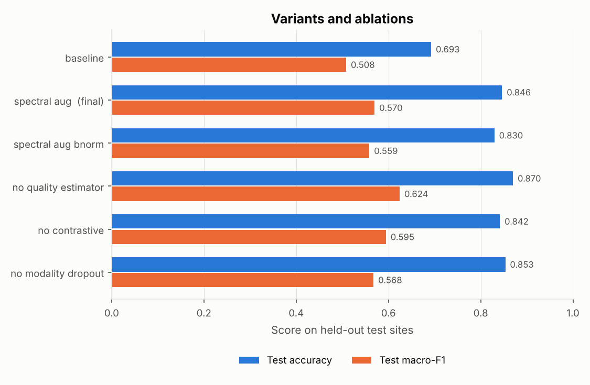
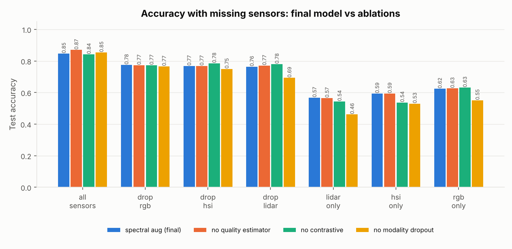
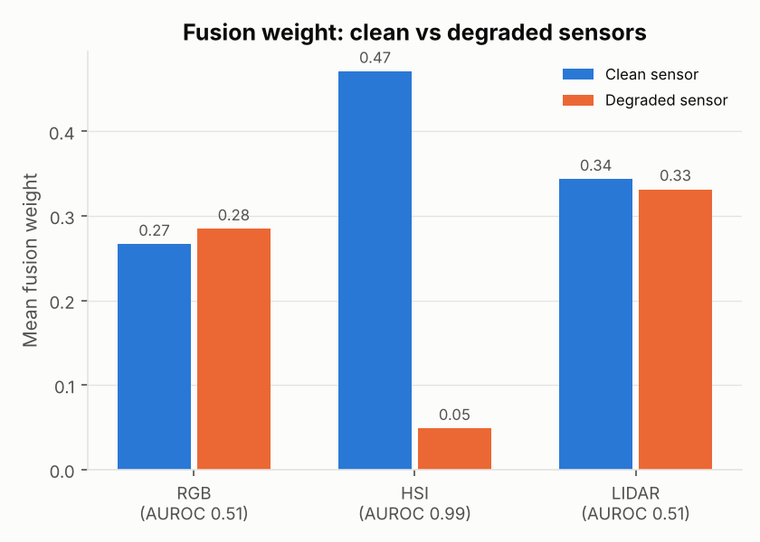
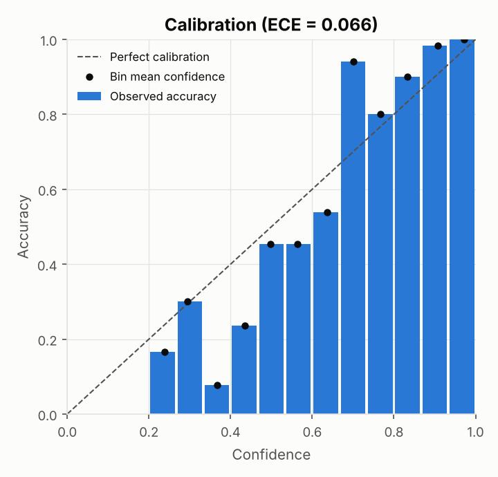
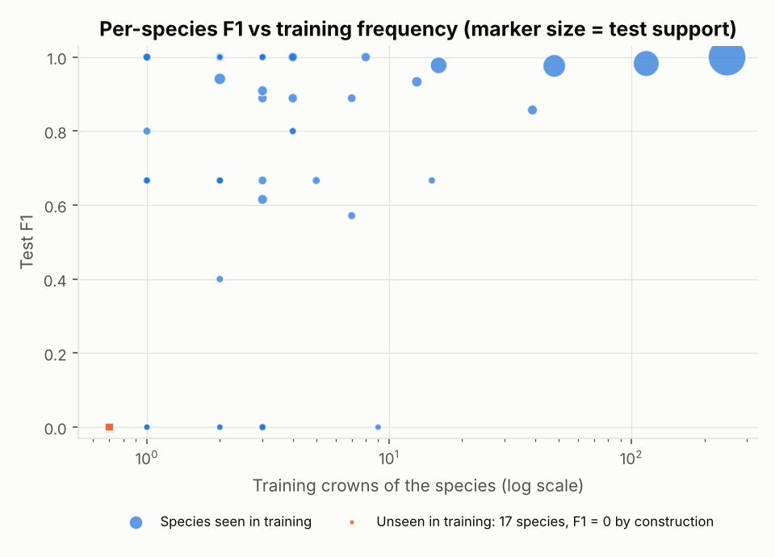
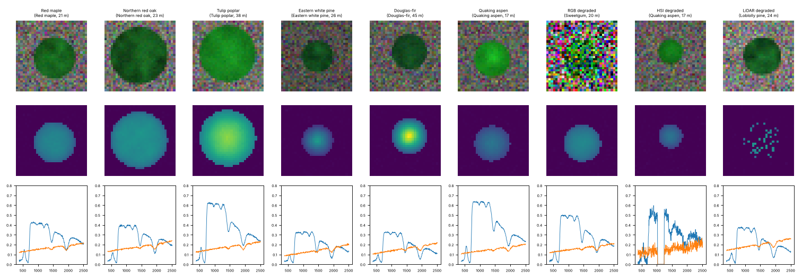
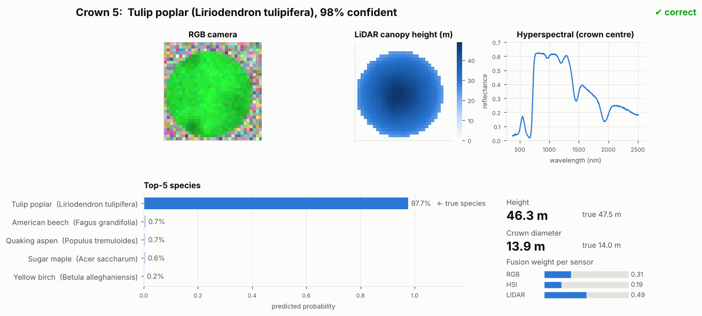

# Adaptive Quality-Aware Multimodal Deep Learning for Robust Tree Species Identification

A PyTorch research codebase that classifies **167 tree species** from three airborne sensors —
**RGB** imagery, **hyperspectral** (369 bands) and **LiDAR** point clouds. For every tree, it learns
**how much to trust each sensor**. It stays usable when a sensor is missing, and it is evaluated on
**sites it has never seen**.

> ### ⚠ Data notice
> No real NEON file was available, so this repo ships a clearly labelled **synthetic** generator,
> `src/data/synthetic.py`. It produces data in a NEON Multi-Modal Tree Crown–like HDF5 layout, and every
> file carries `synthetic=True`. It reproduces the hard parts of the real problem:
> - a long-tailed species distribution
> - look-alike species within each genus
> - per-site illumination and spectral calibration shifts
> - missing sensors
> - degraded sensors (haze, blur, sparse returns)
> - `-9999` / NaN values
>
> All reported numbers therefore show that the **pipeline works and how its parts interact**. They are
> **not** real-world accuracy. To use real data, write it in the layout documented at the top of
> `src/data/synthetic.py` and point `paths.data_file` at it. Nothing else changes.

## Results at a glance

Site-held-out test set: **MLBS, STEI, WREF (423 crowns)**. The final model (`spectral_aug`) was chosen on
**validation** macro-F1. Full tables are in [`results/RESULTS.md`](results/RESULTS.md) and raw numbers in `results/summary.json`.
A self-contained visual summary is in `results/results_page.html`; open it in any browser.

| | Baseline (as specified) | **Final model** (+ cross-site spectral augmentation) |
|---|---|---|
| Test accuracy | 0.693 | **0.846** (3 seeds: 0.849 ± 0.009) |
| Test macro-F1 / weighted-F1 | 0.508 / 0.716 | **0.570 / 0.842** |
| Accuracy, species seen in training | 0.757 | **0.925** |
| Accuracy with one sensor missing (mean of 3) | 0.604 | **0.769** |
| HSI-only accuracy | 0.279 | **0.593** |
| ECE | 0.063 | 0.066 |
| Height / crown-diameter MAE | 2.11 m / 0.44 m | **1.74 m / 0.31 m** (R² 0.93 / 0.98) |



### What the experiments show

1. **Cross-site spectral shift was the main failure, and augmentation fixes it.**
   - In the baseline, removing HSI *raised* test accuracy (0.693 → 0.747). The hyperspectral branch had
     learned site-specific brightness and calibration.
   - Train-time spectral gain/tilt/offset augmentation plus RGB brightness jitter fixes this:
     - val macro-F1 0.372 → 0.559
     - test accuracy +15 points
     - HSI now helps (dropping it costs 7.8 points)
     - HSI-only accuracy doubles
   - Adding per-pixel brightness normalization on top did not help (val 0.531), so it was not selected.
2. **Modality dropout is what makes missing sensors survivable.** Without it:
   - one-missing-sensor accuracy falls by 3.3 points and macro-F1 by 5.1 points
   - LiDAR-only accuracy falls from 0.567 to 0.461
   - In exchange, calibration with all sensors present is better (ECE 0.041 vs 0.066).
3. **The evidential trust scores are informative, but they did not improve accuracy on this data.**
   - **Built-in degradations:** trust spots hazy HSI almost perfectly (AUROC 0.99), cutting HSI's fusion weight from 0.47 to 0.05.
   - **Unseen test-time noise:** it cuts the weight on noisy RGB and HSI from ~0.34 to 0.20 and 0.15.
   - **Where it fails:** blurred RGB and sparse LiDAR (AUROC ≈ 0.5), and it slightly *raises* the weight on jittered LiDAR.
   - **Accuracy vs plain masked-mean fusion over 3 seeds:**
     - test accuracy 0.849 ± 0.009 vs 0.848 ± 0.021
     - mean accuracy under corruption 0.797 vs 0.800
   - So the gain is interpretability: a per-tree, per-sensor reliability score. A follow-up would need to show an accuracy benefit
     on real data, where sensor failures are more varied.
4. **The cross-modal contrastive loss had no measurable effect** (val macro-F1 +0.007 without it, within seed noise).
5. **Long tail and open set.** Every species with ≥ 10 training crowns reaches test F1 ≥ 0.67.
   - The 17 test species that never occur at training sites score F1 = 0 by construction.
   - That's why results are reported both on all trees and on seen species.

| Missing sensors (test acc.) | all | −RGB | −HSI | −LiDAR | LiDAR only | HSI only | RGB only |
|---|---|---|---|---|---|---|---|
| Baseline | 0.693 | 0.574 | 0.747 | 0.489 | 0.539 | 0.279 | 0.537 |
| **Final** | **0.846** | 0.775 | 0.768 | 0.764 | 0.567 | 0.593 | 0.624 |
| Final, no modality dropout | 0.853 | 0.766 | 0.749 | 0.693 | 0.461 | 0.530 | 0.551 |

<p float="left">


</p>
<p float="left">


</p>


## Real-species demo dataset (`demo_tree_crowns.h5` layout)

`scripts/make_real_species_data.py` writes a **synthetic** dataset that uses **real species and NEON site
names**, in exactly the layout of the reference file `demo_tree_crowns.h5`. Every key, dtype and per-sample
shape matches, and the extra descriptive attributes don't change the layout:

| key | shape | dtype | content |
|---|---|---|---|
| `rgb` | (N, 3, 32, 32) | uint8 | reflectance × 255, 0.5 m pixels (16 m window) |
| `hsi` | (N, 369, 8, 8) | float16 | reflectance 380–2510 nm, 2 m pixels |
| `lidar` | (N, 1, 32, 32) | float32 | canopy height model, m |
| `species`, `site` | (N,) | int64 | indices into `attrs['species_names']`, `attrs['site_names']` |
| `height`, `crown_diameter` | (N,) | float32 | m |
| `degraded` | (N, 3) | bool | RGB colour noise / HSI band dropout / sparse LiDAR (≈20 / 15 / 9 %) |
| `wavelengths` | (369,) | float64 | nm |

The dataset covers **20 species** across **10 NEON sites**:
- **Broadleaves:** red and sugar maple; northern red, white and turkey oak; American beech; yellow birch;
  tulip poplar; sweetgum; black gum; quaking aspen.
- **Conifers:** eastern white, longleaf, loblolly and lodgepole pine; eastern and western hemlock;
  balsam fir; Engelmann spruce; Douglas-fir.
- **Sites:** HARV, BART, SCBI, SERC, MLBS, OSBS, TALL, UNDE, NIWO, WREF.

Each species occurs only at sites within its approximate real range (`src/data/species_catalog.py`).
Crown shapes, heights and spectra differ in realistic directions; for example, conifers are darker with
lower NIR and conical height profiles. These **traits are plausible hand-set values, not measurements**.

```bash
python scripts/make_real_species_data.py                       # 2000 crowns → data/real_species_tree_crowns.h5 (~10 s, 83 MB)
python scripts/make_real_species_data.py --num-samples 1000 --sites HARV BART SCBI SERC UNDE
```



A nearest-centroid classifier on simple features gets 25–41 % on held-out sites (chance 5 %). Its errors
are botanically sensible (red maple ↔ sweetgum, white ↔ loblolly pine). The training pipeline in this repo
uses the point-cloud layout of `data/synthetic_neon_mmtc.h5`; training on this layout would need a small
loader adapter.

## Predict species, height and crown diameter (`scripts/predict.py`)

`results/real_species_model.pt` is a model trained on the real-species dataset (`configs/real_species.yaml`).
Its scores on 301 held-out test crowns, split per species:

| Metric | Result |
|---|---|
| Species accuracy | **74.4 %** |
| Macro-F1 | 0.739 |
| True species in the top 5 | 99.7 % |
| Height error (MAE) | 0.90 m (R² 0.98) |
| Crown-diameter error (MAE) | 0.25 m (R² 0.99) |

With **whole sites held out** (SCBI + SERC never seen in training), species accuracy is 59.4 %.

```bash
python scripts/predict.py                                   # 8 random test crowns → predictions/report.html (opens in browser)
python scripts/predict.py --random 20                       # more crowns
python scripts/predict.py --index 5 17 301                  # specific crowns
python scripts/predict.py --drop lidar                      # simulate a missing sensor
python scripts/predict.py --export-examples examples        # save test crowns as PNG/.npy files ...
python scripts/predict.py --rgb examples/crown_1_rgb.png --hsi examples/crown_1_hsi.npy --lidar examples/crown_1_lidar.npy
python scripts/predict.py --rgb my_crown.png                # ... or any subset of your own files
```

Outputs:
- **Console:** top-5 species with probabilities, predicted vs true height and crown diameter, and trust per sensor.
- **`predictions/report.html`:** a self-contained report with summary tiles, whole-test-set reference numbers,
  a table and one card per crown.
- **`predictions/cards/*.png`:** one card per crown, showing the RGB view, LiDAR height map, spectrum, top-5 bars and fusion weights.
- **`predictions/predictions.csv`**

Input format for your own crown, any subset of the three:
- **RGB:** image centred on one crown, about 16 m across.
- **Hyperspectral:** a `.npy` array of 369 bands × h × w (or one spectrum), as reflectance.
- **LiDAR:** a `.npy` canopy-height raster in metres.

The model was trained on simulated data, so real photos are out of distribution and its predictions on them
aren't meaningful.



---

## Reproduce everything

```bash
pip install -r requirements.txt     # CPU-only torch: see the comment in requirements.txt

python -m pytest -v                 # 111 tests, ~60 s on CPU (incl. 2-epoch smoke test)
python scripts/run_experiments.py   # data → 3 variants → select on val → 3 ablations → 4 extra-seed runs → report
                                    #   ≈2.5–3 h on a 2-core CPU (minutes on a GPU); results in outputs/experiments/
```

Individual steps:

```bash
python scripts/make_synthetic_data.py --config configs/default.yaml   # SYNTHETIC demo data (10 s, 181 MB)
python scripts/inspect_data.py                                         # groups / keys / shapes / dtypes
python scripts/train.py --config configs/default.yaml                  # train the final model → outputs/
python scripts/train.py --set data.hsi_aug.enabled=false data.rgb_aug.enabled=false  # baseline as specified
python scripts/train.py --resume outputs/last.pt
python scripts/evaluate.py --checkpoint outputs/best.pt [--split val]  # → outputs/eval_test/
python scripts/evaluate.py --checkpoint results/final_model_best.pt     # shipped final model (needs the data file)
python scripts/run_experiments.py --quick                              # 5-min pipeline check
```

Seeds are fixed (`seed: 42`). The sampler, modality dropout and augmentation are seeded per
(seed, epoch, sample), so retraining reproduces the same numbers: the Phase-5 checkpoint and the
re-run `baseline` both score test accuracy 0.6927. The GPU is used automatically if present, and
mixed precision is available via `train.amp: true`.

## Method

```
 RGB (3×64×64) ──► RGBEncoder (ResNet, GroupNorm) ─────────┐ e_rgb ─► evidential head ─► α_rgb ─► trust t_rgb
 HSI (369×12×12) ─► HSIEncoder (band-compress + spatial ───┤ e_hsi ─► evidential head ─► α_hsi ─► trust t_hsi
                    conv + attention-pooled 1-D spectral)  │
 LiDAR (512×4) ──► LiDAREncoder (masked PointNet + ────────┘ e_lid ─► evidential head ─► α_lid ─► trust t_lid
                    height quantiles / spreads)                       │
                                   modality mask ─────────────────────┤
                 fused = Σ w_m e_m,  w_m ∝ mask_m (t_m + ε)^γ  ◄──────┘
                     ├─► species head (167-way) ── focal loss + class-balanced sampler
                     └─► structure head (height, crown Ø) ── Smooth-L1
   + cross-modal InfoNCE between projected e_rgb / e_hsi / e_lid of the same tree
   + modality dropout during training
```

| Component | File | Key choices |
|---|---|---|
| Encoders | `src/models/encoders.py` | Every encoder outputs 128-d. GroupNorm/LayerNorm only, because missing sensors arrive as zeros and would corrupt BatchNorm statistics. The LiDAR encoder is permutation- and padding-invariant (tested). |
| Quality estimator | `src/models/quality.py` | Per sensor: evidence = exp(clamp(z)), α = evidence + 1, uncertainty u = C/Σα, trust t = (1 − u)·mask. Trained by the evidential loss (`src/losses/evidential.py`): Dirichlet expected cross-entropy plus a KL term annealed over 10 epochs. |
| Fusion | `src/models/fusion.py` | A missing sensor gets weight exactly 0, so nothing leaks from its input (tested for all 7 sensor subsets). `detach_trust: true` stops the classifier from gaming the trust scores. |
| Contrastive | `src/losses/contrastive.py` | Symmetric InfoNCE over the 3 sensor pairs, using only trees that have both sensors. Same-species trees are not counted as negatives. |
| Objective | `src/losses/total.py` | 1.0·focal(γ = 2) + 0.2·InfoNCE + 0.2·structure + 0.5·evidential (all in `loss:`). |
| Training | `src/training/` | Class-balanced sampling p ∝ n_c^−0.5 and modality dropout: half the trees lose each sensor with p = 0.4, and the last sensor is never dropped. AdamW with warm-up + cosine LR, gradient clipping, early stopping on val macro-F1, checkpoints with resume. |
| Cross-site robustness | `src/data/dataset.py` | Optional train-time spectral gain/tilt/offset augmentation and RGB brightness jitter (`data.hsi_aug`, `data.rgb_aug`), plus optional per-pixel spectral brightness normalization (`data.hsi_brightness_norm`). |

### Data handling (`src/data/`)

| Sensor | Stored | Invalid values | Normalization (fit on train sites only) |
|---|---|---|---|
| RGB | `(N,3,64,64)` uint8 | all-zero crop ⇒ missing | per-channel z-score |
| HSI | `(N,369,12,12)` int16 ×10000 | `-9999`, NaN/inf or >1.5 reflectance ⇒ invalid pixel, filled with the band mean; <25 % valid ⇒ missing | per-band z-score |
| LiDAR | `(N,1024,4)` float32, NaN-padded | non-finite xyz ⇒ point dropped; NaN intensity ⇒ mean; <16 points ⇒ missing | xy recentred and scaled, z & intensity z-scored; 512 points + mask |

**Split:** `src/data/splits.py` puts **whole sites** in train, val or test, never random rows.
Tests assert that no site appears in two splits.

With seed 42 the split is:

| Split | Sites | Trees |
|---|---|---|
| Train | 9 | 1222 |
| Val | 4 | 355 |
| Test | MLBS, STEI, WREF | 423 |

17 test species (36 trees) never occur at the training sites, so they cannot be predicted. Every metric is
therefore reported on **all** test trees and again on **seen-species** trees.

## Evaluation (`src/evaluation/`)

- **Classification:** accuracy, top-5, macro/weighted precision, recall and F1, per-species P/R/F1 (`per_species.csv`),
  confusion matrix, expected calibration error (15 bins), NLL.
- **Missing sensors:** results for 7 sensor subsets (all; drop each one; each one alone), each with its drop
  vs all sensors.
- **Structure and sites:** per-site metrics; height and crown-diameter MAE/RMSE/R².
- **Silent corruption:** sensors are corrupted at test time but stay marked as present (2σ noise on RGB or HSI; LiDAR
  jitter with 80 % of points removed). This checks whether fusion re-weights them.
- **Trust:** trust and fusion weight for clean vs degraded sensors, plus AUROC for spotting a degraded sensor.
  This uses the synthetic generator's ground-truth degradation flags.
- **Plots:** missing-sensor bars, reliability diagram, confusion matrix, F1 vs training frequency,
  trust weights, run comparison.

## Tests

| File | Covers |
|---|---|
| `test_dataset.py` | schema check, NaN/-9999/saturation handling, LiDAR invalid points, missing ⇒ zeros + mask, train-only normalization, deterministic eval items, robustness options |
| `test_splits.py` | **no site overlap** (5 seeds), full coverage, explicit sites, bad configs |
| `test_encoders.py` | output shape of each encoder, finite output on missing inputs, LiDAR padding/permutation invariance, gradients |
| `test_fusion.py` | trust range, fusion for all 7 sensor subsets (missing ⇒ weight 0, garbage-invariant), detach, full model |
| `test_losses.py` / `test_training.py` | evidential, InfoNCE, focal, class-balanced weights/sampler, modality dropout, LR/KL schedules |
| `test_smoke.py` | **2 epochs on 64 samples on CPU < 2 min** (≈4 s), bit-reproducible training, resume |
| `test_evaluation.py` | hand-computed P/R/F1, ECE, top-k, end-to-end evaluation (missing + corrupted sensors) and report files |

## Project structure

```
configs/       default.yaml (all hyperparameters & paths) · experiments.yaml (variants & ablations)
data/          synthetic_neon_mmtc.h5 (generated)
src/data/      synthetic.py · inspect.py · dataset.py · splits.py · species_catalog.py · real_species.py · crown_dataset.py
src/models/    encoders.py · quality.py · fusion.py · heads.py · model.py
src/losses/    focal.py · evidential.py · contrastive.py · total.py
src/training/  trainer.py · sampler.py · modality_dropout.py
src/evaluation/ metrics.py · predict.py · evaluate.py · plots.py · report.py · predictor.py · predict_report.py
src/utils/     common.py (config, seeding, device, logging)
scripts/       make_synthetic_data.py · make_real_species_data.py · inspect_data.py · predict.py · train.py · evaluate.py · run_experiments.py
tests/         111 pytest tests
results/       RESULTS.md · summary.json · results_page.html · figures/ · final_model_best.pt
```

## Limitations

- **Synthetic data only.** The site shift, the degradations and the cross-site augmentation are all simple
  parametric families. The augmentation family also matches the simulated shift, so its benefit here
  is an upper bound on what to expect from real NEON flight-line differences.
- **Seeds.** Three seeds were run for the final model and its no-quality-estimator ablation; every other
  configuration has one seed. Seed-to-seed spread on test accuracy is about ±0.01–0.02, so smaller differences are noise.
- **Trust is a model-confidence signal.** It detects corruptions that make a sensor less informative in the
  way the training data showed. It does **not** detect distribution shift to new sites on its own
  (see Results).
- The 167-way head cannot recognise species absent from the training sites (open-set recognition is out of scope).
# multimodal-tree-species-identification

